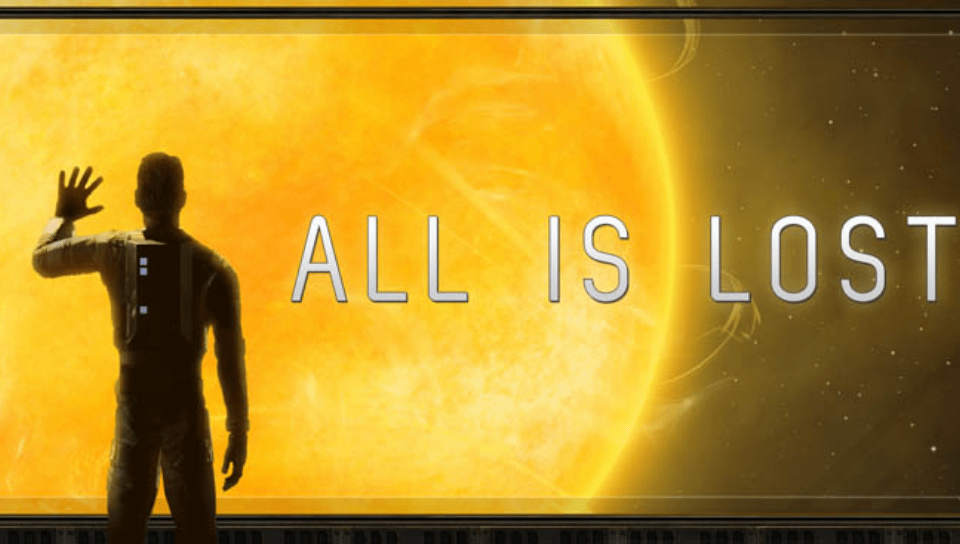

<h1 align="center">
<br>
All is Lost · PSVita Port
</h1>
<p align="center">
  <a href="#setup-instructions-for-end-users">How to install</a> •
  <a href="#controls">Controls</a> •
  <a href="#build-instructions-for-developers">How to compile</a> •
  <a href="#credits">Credits</a> •
  <a href="#license">License</a>
</p>

All is Lost is a game created by Foursaken Media.

In the distant future, mankind is scattered across a vast and dangerous universe. The crews of massive space stations live in a constant struggle for survival. How many can you save?

Space Stations across the galaxy are on the brink of destruction, and its up to you to save as many crew as possible before the stations go down in flames! 

Control ship systems and direct crew members to safety in a game that will test your reflexes to the limit! 

This repository contains a loader of **the Android release of Arcaea**, based
on the [Android SO Loader by TheFloW](https://github.com/TheOfficialFloW/gtasa_vita).
The loader provides a tailored, minimalistic Android-like environment to run
the official ARMv7 game executables on the PS Vita.

**This software does not contain the original code, executables, assets, or other
not redistributable parts of the game. The authors do not promote or condone piracy
in any way. To launch and play the game on their PS Vita device, users must provide
their own legally obtained copy of the game in form of an .apk file.**

## Setup Instructions (For End Users)

In order to properly install the game, you'll have to follow these steps precisely:

- Install [kubridge](https://github.com/TheOfficialFloW/kubridge/releases/) and [FdFix](https://github.com/TheOfficialFloW/FdFix/releases/) by copying `kubridge.skprx` and `fd_fix.skprx` to your taiHEN plugins folder (usually `ur0:tai`) and adding two entries to your `config.txt` under `*KERNEL`:
```
  *KERNEL
  ur0:tai/kubridge.skprx
  ur0:tai/fd_fix.skprx
```
**Note** Don't install fd_fix.skprx if you're using rePatch plugin!
- Make sure you have `libshacccg.suprx` in the `ur0:/data/` folder on your console. If you don't, follow [this guide](https://samilops2.gitbook.io/vita-troubleshooting-guide/shader-compiler/extract-libshacccg.suprx) to extract it.
- <u>Legally</u> obtain your copy of [All is Lost](https://play.google.com/store/apps/details?id=com.foursakenmedia.spacerunner&hl=en) for Android in form of an `.apk` file and the data files in the format of `.obb`.
  - The SHA256 hashes of the needed files should match so, you can check them using an online tool if you search it:
    ```text
    f3c0f544605d834800d6ea94f7000ca7a0c996b91489ccf141f3cd85ffba022f  liborigingame.so
    bc8c352d32d25f8a00db56b87f68a05f09e7e677374262ff5df06ddd309026c1  main.obb
    aa45df56af7ea9463ced4f97f9375c4e372a0f0dff18cedaa246012416d65817  patch.obb
    ```
  - Versions supported: `1.00.03.1 - Tegra`.
- Open the `.apk` with any zip explorer (like [7-Zip](https://www.7-zip.org/)) and extract `assets` folder from the `.apk` into `ux0:data/ail`. Also, extract `liborigingame.so` from `lib/armeabi-v7a/` in the same directory.
- Transfer `main.obb` and `patch.obb` into `ux0:data/ail`.

  Your final folder layout should look like:
  ```
   └── ail/
    ├── assets/
    ├── liborigingame.so
    ├── main.obb
    ├── patch.obb
  ```
- Install `ail.vpk` (from [Releases](https://github.com/memory-hunter/all-is-lost-vita/releases/latest)).

Controls
-----------------

It only has touch support. No buttons are used.

## Build Instructions (For Developers)

In order to build the loader, you'll need a [vitasdk](https://github.com/vitasdk) build fully compiled with softfp usage.
You can get your environment started nicely by following [Rocroverss's Vita .so porting guide](https://github.com/Rocroverss/vitasoguide?tab=readme-ov-file#section2).
Everything that is required should be available after installing your environment by following the instructions in the README.md of the guide.

After all these requirements are met, you can compile the loader with the following commands:

```bash
cmake -B build .
cmake --build build
```

## Credits
- [Andy "The FloW" Nguyen](https://github.com/TheOfficialFloW/) for the original .so loader.
- [Rinnegatamante](https://github.com/Rinnegatamante/) for VitaGL and lots of help with understanding and debugging the loader.
- [gl33ntwine](https://github.com/v-atamanenko/) for the [SoLoBoP (.**so** **lo**ader **bo**iler**p**late)](https://github.com/v-atamanenko/soloader-boilerplate/), help with the SharedPreferences parsing functions, this README.md as a template copied from [Baba is You! port](https://github.com/v-atamanenko/baba-is-you-vita/) and overall help.
- [devnoname120](https://github.com/devnoname120/) for diagnosing few graphical issues and reimplementing OpenSLES and pthread for the game to have worked properly.

## License
This software may be modified and distributed under the terms of
the MIT license. See the [LICENSE](LICENSE) file for details.

[cross]: https://raw.githubusercontent.com/v-atamanenko/sdl2sand/master/img/cross.svg "Cross"
[circl]: https://raw.githubusercontent.com/v-atamanenko/sdl2sand/master/img/circle.svg "Circle"
[squar]: https://raw.githubusercontent.com/v-atamanenko/sdl2sand/master/img/square.svg "Square"
[trian]: https://raw.githubusercontent.com/v-atamanenko/sdl2sand/master/img/triangle.svg "Triangle"
[joysl]: https://raw.githubusercontent.com/v-atamanenko/sdl2sand/master/img/joystick-left.svg "Left Joystick"
[dpadh]: https://raw.githubusercontent.com/v-atamanenko/sdl2sand/master/img/dpad-left-right.svg "D-Pad Left/Right"
[dpadv]: https://raw.githubusercontent.com/v-atamanenko/sdl2sand/master/img/dpad-top-down.svg "D-Pad Up/Down"
[selec]: https://raw.githubusercontent.com/v-atamanenko/sdl2sand/master/img/dpad-select.svg "Select"
[start]: https://raw.githubusercontent.com/v-atamanenko/sdl2sand/master/img/dpad-start.svg "Start"
[trigl]: https://raw.githubusercontent.com/v-atamanenko/sdl2sand/master/img/trigger-left.svg "Left Trigger"
[trigr]: https://raw.githubusercontent.com/v-atamanenko/sdl2sand/master/img/trigger-right.svg "Right Trigger"
